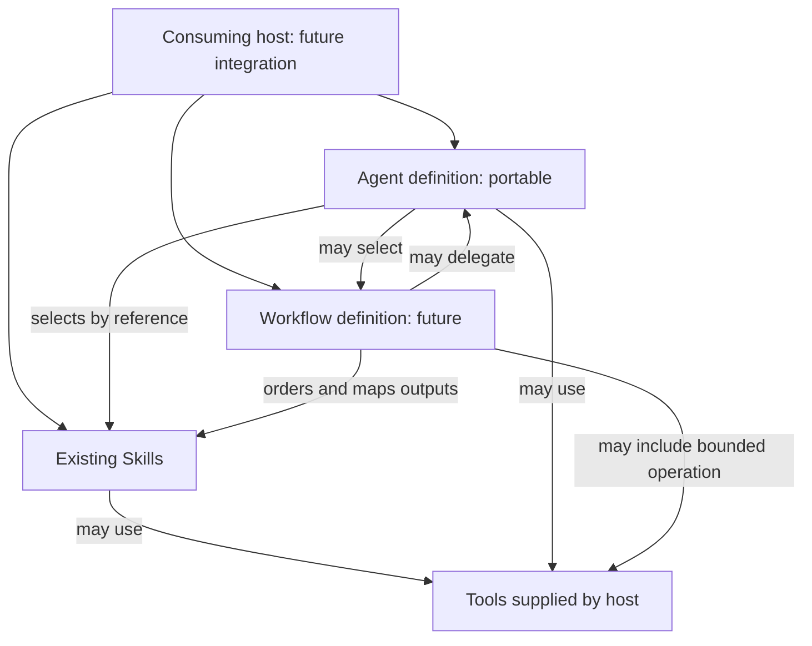

# Repository Architecture

Status: architecture foundation established; agent execution, workflow execution,
adapters, a repository CLI, and automated cross-component validation are not
implemented in this phase.

Current authoring state: twelve Skills, including Agent Factory, with bilingual
usage guides. Skill Factory is version 1.2.1, maintains the guide convention and
bundles its required authoring templates within its own installation package.
The validation records describe the earlier architecture and Agent Factory
creation snapshots; they are not a continuously updated test result for this tree.

## Purpose and boundaries

Evolve the existing Skill library into a library of reusable AI components while
preserving established Skill paths, identities, package ownership and valid behavior. This
repository owns source definitions and authoring standards. A consuming host owns
execution, permissions, model selection, installation state, and credentials.

The abstraction ladder is a selection guide, not a required execution stack:

| Abstraction | Use when | Owns |
| --- | --- | --- |
| Prompt | One focused request needs no reusable procedure | Task instruction |
| Skill | A reusable capability needs stable guidance | Procedure, supporting resources, output quality |
| Workflow | Several capabilities need an explicit process | Ordering, input/output handoffs, completion and failure rules |
| Agent | A bounded responsibility needs delegated judgment or an independent context | Selection, scope, permitted actions, delegation and consolidated evidence |
| Application | A persistent product needs a runtime and user experience | Product execution and operational lifecycle |

Tools perform concrete operations. They are execution capabilities, not another
level in this ladder. A Skill may use tools without an agent or workflow package.
A workflow may compose Skills and tools without specialized agents.

## Established structure

```text
agentic-skills/
├── AGENTS.md
├── README.md
├── agents/
│   ├── README.md                    # Authoring and packaging guide
│   └── backend-engineer/AGENT.md    # Portable definition
├── contracts/
│   ├── components.md               # Identity, discovery, references, compatibility
│   ├── agents.md                   # Agent definition and handoff requirements
│   └── workflows.md                # Declarative process requirements
├── docs/
│   ├── architecture.md
│   ├── architecture-validation.md
│   └── agent-factory-validation.md
├── examples/                       # Existing local outputs; currently Git-ignored
├── skills/                         # Twelve Skills, including agent-factory
│   ├── skill-factory/
│   │   ├── SKILL.md
│   │   ├── examples/usage.md        # Spanish first, English second; language links
│   │   └── templates/
│   │       ├── skill-template.md    # Canonical Skill authoring template
│   │       └── usage-template.md    # Bilingual usage guide scaffold
│   └── <other-skill-directory>/
│       ├── SKILL.md
│       └── examples/usage.md
├── templates/
│   ├── agent-template.md           # Authoring templates, not discoverable components
│   └── workflow-template.md
├── validators/
│   └── README.md                    # Review checks and future automation boundary
└── workflows/
    └── README.md                    # Authoring and packaging guide; no workflows yet
```

The tree omits `.git/`, `.gitignore`, ignored `.archify/` working files, and
component-local supporting files for readability. No runtime configuration changes
are required. `agents/` contains a definition and guide; `workflows/` contains
an authoring guide. The workflow guide lives at `workflows/README.md`.

## Ownership and source of truth

| Location | Responsibility | Boundary |
| --- | --- | --- |
| `AGENTS.md` | Repository-wide contribution instructions | Does not catalog components or define a reusable agent |
| `README.md` | Human catalog, navigation and existing Skill installation guidance | Does not define runtime behavior |
| `skills/<directory>/SKILL.md` | Existing reusable capability | Supporting resources remain inside its package |
| `agents/<name>/AGENT.md` | Portable agent definition | No provider configuration in the canonical definition |
| `workflows/<name>/WORKFLOW.md` | Future declarative workflow definition | No executable commands or engine DSL required |
| `contracts/` | Shared authoring contracts | No runtime protocol or retroactive Skill migration |
| Root `templates/` | Agent and workflow authoring structures | No deliverable templates owned by a particular component |
| `validators/` | Cross-component review rules and future static validators | No agent execution or Skill-specific artifact validation |
| `docs/` | Decisions, analysis and validation evidence | No competing operational definitions |
| Root `examples/` | Representative generated outputs | Existing ignore policy remains in place |

Each Skill includes a bilingual `examples/usage.md`. Additional `references/`,
`templates/`, `examples/`, and `scripts/` belong inside their owning component and
remain conditional on actual value. Do not create a shared resource directory to avoid
declaring a dependency. Authoring contracts are repository development resources;
an installed existing Skill must not need this repository's root directories.

## Composition and execution boundary



Arrows describe allowed relationships, not installed integrations. Actual required
dependency graphs must be acyclic. The diagram permits both directions between
types; an individual agent/workflow pair must not depend on each other.

An agent selects a Skill by its declared name, supplies scoped inputs, reads its
canonical instructions, and checks its output against that Skill's criteria. It
does not copy the Skill workflow into its own definition. Merely referring to a
Skill is not evidence that it was installed or executed.

A workflow owns the process between components. It records what each step
consumes, produces, and needs before continuing. It does not redefine the internal
procedure of its referenced Skills. Tools are described by required capability,
inputs, effects and failure behavior; host-specific tool names are future adapter
concerns. Missing required capabilities block the affected operation.

## Decisions and alternatives

| Decision | Alternatives considered | Rationale and consequence |
| --- | --- | --- |
| Preserve Skill identities and metadata profiles | Move all components into a new common tree; migrate all metadata | The initial architecture change left existing Skill files identical. Later authoring changes and guide additions retain component paths and use the existing Skill metadata profile |
| Bundle authoring templates in `skills/skill-factory/templates/` | Keep a sibling `skills/templates/` directory | Installing only Skill Factory must include its required resources; sibling folders are not part of its package |
| Add sibling `agents/` and `workflows/` with authoring guides | Documentation-only path reservations; complete runtime scaffolding | Makes ownership and onboarding visible without introducing functional components |
| Use portable Markdown entry points with YAML frontmatter for future definitions | Provider-native `.agent.md`; executable workflow YAML | Fits repository authoring conventions and enables discovery without selecting a runtime; workflow execution representation remains deferred |
| Use written contracts before machine schemas | Implement validators and a universal manifest now | Avoids dependency and migration overhead before real consumers exist; validation is currently review-based |
| Keep source files authoritative | Hand-maintained registry, groups, lockfiles and duplicate catalogs | Reduces drift; a future catalog can be derived from canonical entry points |
| Separate shared authoring templates from component deliverable templates | Move the existing Skill template; centralize all templates | Clarifies ownership while preserving the current Skill package convention |

The accepted cost is that neutral definitions will require host translation and
runtime testing later. These contracts do not claim native compatibility with any
agent selector, SDK, or workflow runner.

## Future integrations and CLI seam

No adapters are created now. A future adapter must consume portable definitions
and preserve their constraints while mapping them to actual host capabilities.

- **Codex:** preserve existing Skill packages and repository instruction handling.
  Define and verify any specialized-agent mapping separately; `AGENT.md` is not a
  claim of automatic discovery by Codex.
- **Strands Agents:** map role, Skill references, tool capabilities, and handoff
  ownership into a separately tested integration. No SDK imports, cloud defaults,
  or model settings belong in the portable core.
- **Other hosts:** follow the same boundary. Declare unsupported features and
  block dependent actions rather than silently weakening constraints.

A future CLI can derive discovery from the entry-point rules in
[the common contract](../contracts/components.md). Discovery must not execute a
component. Installation must resolve the complete required dependency closure and
include each package's local resources. Execution requires an explicitly selected,
tested adapter and runtime permissions. A definition's status or dependency list
does not grant permission to run it.

Defer command names, distribution format, version-range resolution, installation
targets, lockfiles, adapter layout, and execution APIs until a real consumer
requires them. For reproducibility, a future installer must record an immutable
source revision and resolved component versions; this phase creates no lockfile.

## Incremental phases and acceptance gates

| Phase | Deliverable | Acceptance evidence |
| --- | --- | --- |
| 1: architecture, current | Contracts, authoring guides, templates and documentation | Existing Skills unchanged; links, inventory and scope checks recorded |
| 2: static validation | Small cross-component validator and focused valid/invalid fixtures | Detect duplicate identities, missing dependencies, cycles, template leakage and broken local resources; require no component execution |
| 3: one agent pilot | One justified specialist referencing existing Skills | Test real tasks, missing Skill/tool, authorization limits, handoff evidence and failure reporting in one selected host |
| 4: one workflow pilot | Small process built from existing capabilities | Verify input/output mapping, ordering, failed/blocked steps and absence of instruction duplication; decide execution representation only if needed |
| 5: portability | A second host integration, potentially Strands Agents | Same scoped tasks and constraints verified across both hosts; unsupported behavior documented |
| 6: distribution and optional CLI | Discovery, installation, then execution only if justified | Deterministic inventory, package closure, reproducible installs, explicit execution and adapter compatibility checks |

New Skills remain independent work: add one only for a demonstrated reusable gap,
using the existing Skill authoring process and proportional execution evidence.
Neither an agent factory nor a mandatory orchestrator is a prerequisite.

Revisit the architecture when actual consumers require machine-readable process
graphs, independently distributed shared resources, version constraints, or
repeated adapter implementations. Do not create those abstractions in advance.

## Compatibility and reversal

No component is renamed or moved. Existing installation commands are retained;
their execution is outside this phase. Existing outputs and working files remain
untouched, including inherited non-English asset filenames and generated content.
Operational instructions remain English. User-facing usage guides have Spanish
and English sections under the repository's explicit language exception; inherited
assets and generated content are not renamed or translated by that convention.

Reversing this phase consists of reverting its documentation/template additions
and the root documentation edits. No runtime state, dependency installation,
generated code, or Skill migration needs to be reversed.

See [phase validation](architecture-validation.md) for performed checks and limits.
