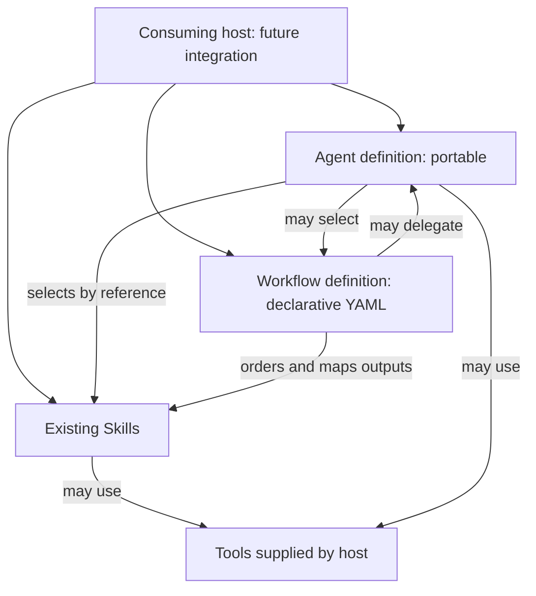

# Repository Architecture

Status: component library with portable agent definitions, a draft declarative
YAML workflow and a shared static validator with manual semantic review. There is no workflow
executor, host adapter or repository CLI.

Current authoring state: fourteen Skills, including Code Review, with bilingual
usage guides. Skill Factory is version 1.2.2, maintains the guide convention and
bundles its required authoring templates within its own installation package.
Two portable engineer definitions have pilot records. The reference workflow
remains `draft` and has static review only. Validation records describe their
inspected snapshots, not a continuously updated test result for this tree.

## Purpose and boundaries

Evolve the existing Skill library into a library of reusable AI components while
preserving established Skill paths, identities, package ownership and valid behavior. This
repository owns source definitions and authoring standards. A consuming host owns
execution, permissions, model selection, installation state, and credentials.

The abstraction ladder is a selection guide, not a required execution stack:

| Abstraction | Use when | Owns |
| --- | --- | --- |
| Prompt | One focused request needs no reusable procedure | Task instruction |
| Skill | A reusable capability needs stable guidance | Procedure, supporting resources, output quality |
| Workflow | Several capabilities need an explicit process | Ordering, input/output handoffs, completion and failure rules |
| Agent | A bounded responsibility needs delegated judgment or an independent context | Selection, scope, permitted actions, delegation and consolidated evidence |
| Application | A persistent product needs a runtime and user experience | Product execution and operational lifecycle |

Tools perform concrete operations. They are execution capabilities, not another
level in this ladder. A Skill may use tools without an agent or workflow package.
A workflow may compose Skills that use tools without specialized agents.

## Established structure

```text
agentic-skills/
├── AGENTS.md
├── README.md
├── agents/
│   ├── README.md                    # Authoring and packaging guide
│   ├── backend-engineer/AGENT.md    # Portable definition
│   └── frontend-engineer/AGENT.md   # Portable definition
├── contracts/
│   ├── components.md               # Identity, discovery, references, compatibility
│   ├── agents.md                   # Agent definition and handoff requirements
│   └── workflows.md                # Declarative process requirements
├── docs/
│   ├── architecture.md
│   ├── architecture-validation.md
│   └── agent-factory-validation.md
├── examples/                       # Existing local outputs; currently Git-ignored
├── skills/                         # Fourteen Skills, including code-review
│   ├── skill-factory/
│   │   ├── SKILL.md
│   │   ├── examples/usage.md        # Spanish first, English second; language links
│   │   └── templates/
│   │       ├── skill-template.md    # Canonical Skill authoring template
│   │       └── usage-template.md    # Bilingual usage guide scaffold
│   └── <other-skill-directory>/
│       ├── SKILL.md
│       └── examples/usage.md
├── templates/
│   ├── agent-template.md           # Authoring templates, not discoverable components
│   └── workflow-template.yaml
├── validators/
│   ├── README.md                    # Commands, coverage and manual review checks
│   ├── requirements.txt             # Validator-only parser dependency
│   ├── validate_components.py       # Read-only structural checks
│   └── tests/test_validate_components.py
└── workflows/
    ├── README.md                    # Authoring guide and workflow catalog
    └── architecture-security-review/workflow.yaml  # Draft reference
```

The tree omits `.git/`, `.gitignore`, ignored `.archify/` working files, additional
validation records and component-local resources for readability. No runtime configuration changes
are required. `agents/` contains definitions and a guide; `workflows/` contains
a guide and one declarative reference. The workflow guide lives at `workflows/README.md`.

## Ownership and source of truth

| Location | Responsibility | Boundary |
| --- | --- | --- |
| `AGENTS.md` | Repository-wide contribution instructions | Does not catalog components or define a reusable agent |
| `README.md` | Human catalog, navigation and existing Skill installation guidance | Does not define runtime behavior |
| `skills/<directory>/SKILL.md` | Existing reusable capability | Supporting resources remain inside its package |
| `agents/<name>/AGENT.md` | Portable agent definition | No provider configuration in the canonical definition |
| `workflows/<name>/workflow.yaml` | Canonical declarative process graph | No executable commands or engine DSL |
| `contracts/` | Shared authoring contracts | No runtime protocol or retroactive Skill migration |
| Root `templates/` | Agent and workflow authoring structures | No deliverable templates owned by a particular component |
| `validators/` | Cross-component static checks, tests and manual review rules | No component execution or Skill-specific artifact validation |
| `docs/` | Decisions, analysis and validation evidence | No competing operational definitions |
| Root `examples/` | Representative generated outputs | Existing ignore policy remains in place |

Each Skill includes a bilingual `examples/usage.md`. Additional `references/`,
`templates/`, `examples/`, and `scripts/` belong inside their owning component and
remain conditional on actual value. Do not create a shared resource directory to avoid
declaring a dependency. Authoring contracts are repository development resources;
an installed existing Skill must not need this repository's root directories.

## Composition and execution boundary



Arrows describe allowed relationships, not installed integrations. Actual required
dependency graphs must be acyclic. The diagram permits both directions between
types; an individual agent/workflow pair must not depend on each other.

An agent selects a Skill by its declared name, supplies scoped inputs, reads its
canonical instructions, and checks its output against that Skill's criteria. It
does not copy the Skill workflow into its own definition. Merely referring to a
Skill is not evidence that it was installed or executed.

A workflow owns the process between components. It records what each step
consumes, produces, and needs before continuing. It does not redefine the internal
procedure of its referenced Skills. Tools are described by required capability,
inputs, effects and failure behavior; host-specific tool names are future adapter
concerns. Missing required capabilities block the affected operation.

## Decisions and alternatives

| Decision | Alternatives considered | Rationale and consequence |
| --- | --- | --- |
| Preserve Skill identities and metadata profiles | Move all components into a new common tree; migrate all metadata | The initial architecture change left existing Skill files identical. Later authoring changes and guide additions retain component paths and use the existing Skill metadata profile |
| Bundle authoring templates in `skills/skill-factory/templates/` | Keep a sibling `skills/templates/` directory | Installing only Skill Factory must include its required resources; sibling folders are not part of its package |
| Keep sibling `agents/` and `workflows/` packages | Documentation-only reservations; complete runtime scaffolding | Makes ownership and onboarding visible while separating definitions from execution |
| Keep agents in Markdown and workflows in declarative YAML | Provider-native definitions; Markdown process tables; engine-specific workflow YAML | Agent judgment benefits from prose; process graphs benefit from explicit mappings. Workflow profile 2.0 replaces the unused Markdown reservation without migrating agents or Skills |
| Pair written contracts with a small static validator | Universal schemas, a manifest and an executor | Deterministic structural checks support growth while semantic review and runtime evidence stay separate; PyYAML is isolated to validator tooling |
| Keep source files authoritative | Hand-maintained registry, groups, lockfiles and duplicate catalogs | Reduces drift; a future catalog can be derived from canonical entry points |
| Separate shared authoring templates from component deliverable templates | Move the existing Skill template; centralize all templates | Clarifies ownership while preserving the current Skill package convention |

The accepted cost is that neutral definitions will require host translation and
runtime testing later. These contracts do not claim native compatibility with any
agent selector, SDK, or workflow runner.

## Future integrations and CLI seam

No adapters are created now. A future adapter must consume portable definitions
and preserve their constraints while mapping them to actual host capabilities.

- **Codex:** preserve existing Skill packages and repository instruction handling.
  Define and verify any specialized-agent mapping separately; `AGENT.md` is not a
  claim of automatic discovery by Codex.
- **Strands Agents:** map role, Skill references, tool capabilities, and handoff
  ownership into a separately tested integration. No SDK imports, cloud defaults,
  or model settings belong in the portable core.
- **Other hosts:** follow the same boundary. Declare unsupported features and
  block dependent actions rather than silently weakening constraints.

A future CLI can derive discovery from the entry-point rules in
[the common contract](../contracts/components.md). Discovery must not execute a
component. Installation must resolve the complete required dependency closure and
include each package's local resources. Execution requires an explicitly selected,
tested adapter and runtime permissions. A definition's status or dependency list
does not grant permission to run it.

Defer command names, distribution format, version-range resolution, installation
targets, lockfiles, adapter layout, and execution APIs until a real consumer
requires them. For reproducibility, a future installer must record an immutable
source revision and resolved component versions; this phase creates no lockfile.

## Incremental phases and acceptance gates

| Phase | Deliverable | Acceptance evidence |
| --- | --- | --- |
| Architecture foundation: established | Contracts, authoring guides, templates and documentation | Initial snapshot recorded in architecture-validation.md; later changes preserve Skill package identities |
| Agent pilots: initial evidence recorded | Backend and frontend engineer definitions referencing existing capabilities | See backend-engineer-validation.md and frontend-engineer-pilot.md for actual scope and limits; no native host registration is implied |
| YAML process definition: current | Draft architecture/security review and profile 2.0 template | YAML parsing, dependency and step graphs, source mappings and semantic review; no host execution |
| Shared static validation: implemented | Small Python validator and isolated valid/invalid package tests | Detect duplicate identities, missing dependencies, cycles, invalid source mappings and broken local resources without component execution; see component-validator-validation.md |
| Workflow host pilot: future | Exercise the reference process in a selected host | Verify success, missing input, unavailable capabilities and blocked steps before ready status; design an executor only if needed |
| 5: portability | A second host integration, potentially Strands Agents | Same scoped tasks and constraints verified across both hosts; unsupported behavior documented |
| 6: distribution and optional CLI | Discovery, installation, then execution only if justified | Deterministic inventory, package closure, reproducible installs, explicit execution and adapter compatibility checks |

New Skills remain independent work: add one only for a demonstrated reusable gap,
using the existing Skill authoring process and proportional execution evidence.
Neither an agent factory nor a mandatory orchestrator is a prerequisite.

Revisit the architecture when actual consumers require executable process
semantics, independently distributed shared resources, version constraints, or
repeated adapter implementations. Do not create those abstractions in advance.

## Compatibility and reversal

No existing Skill or agent is renamed or moved. Workflow authoring moves from
the previously reserved Markdown format to YAML; no existing workflow package
needed migration. Existing installation commands are retained, and their
execution is outside this change. Existing outputs and working files remain
untouched, including inherited non-English asset filenames and generated content.
Operational instructions remain English. User-facing usage guides have Spanish
and English sections under the repository's explicit language exception; inherited
assets and generated content are not renamed or translated by that convention.

Reversing the YAML change consists of removing the draft reference and restoring
the prior workflow contract, template and documentation. No runtime state,
dependency installation, generated application code or Skill migration is involved.

See [initial architecture validation](architecture-validation.md) and
[YAML workflow validation](workflow-yaml-validation.md) for performed checks and limits.
See [component validator validation](component-validator-validation.md) for shared
automation evidence and its manual review boundaries.
